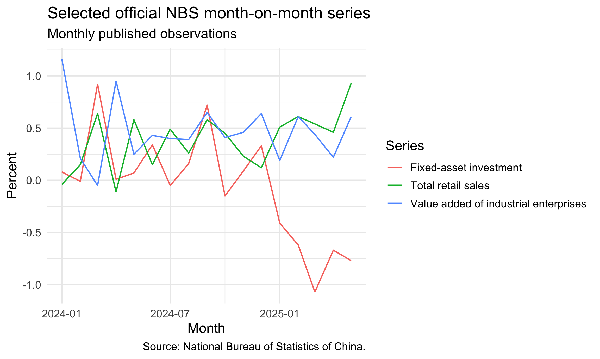

readNBS
================

- [Install](#install)
- [First success, offline](#first-success-offline)
- [Retrieve and chart a time series](#retrieve-and-chart-a-time-series)
- [What is covered](#what-is-covered)
- [Output contract](#output-contract)
- [Common workflows](#common-workflows)
- [Authentication, network, cache, and
  configuration](#authentication-network-cache-and-configuration)
- [Scope and limitations](#scope-and-limitations)
- [Documentation and support](#documentation-and-support)
- [Citation and rights](#citation-and-rights)
- [Contributing](#contributing)

[](https://github.com/chartwell-macro/readNBS/actions/workflows/R-CMD-check.yaml)
[](https://github.com/chartwell-macro/readNBS/actions/workflows/pkgdown.yaml)

`readNBS` is an R client for selected official time series and release
tables from the National Bureau of Statistics of China (NBS). It gives
analysts and researchers a stable semantic layer over the public NBS
National Data portal, while preserving the reporting periods, source
vintages, classification eras, and provenance of the underlying
releases.

The package is authored and maintained by **Chartwell Macro**.

The package is useful when you need to:

- find a series by a stable bilingual identifier rather than a portal
  UUID;
- select an exact, published combination from a dimensional release
  panel;
- fetch current/revised portal observations or read a retained official
  release history without crawling old pages; or
- keep source dates, reporting windows, hashes, release URLs, and
  caveats with values in a reproducible analysis.

## Install

Install the current development package from GitHub. While the
repository is private, authenticate with an account that has access:

``` r
install.packages("remotes")
remotes::install_github("chartwell-macro/readNBS")
```

After a future CRAN acceptance, installation will use the standard CRAN
form:

``` r
install.packages("readNBS")
```

The CRAN command is aspirational until `readNBS` appears in the CRAN
package index.

## First success, offline

The fastest first check reads a retained official seasonally adjusted
revision history bundled with the package. The workflow is
self-contained: it uses an in-memory client, local package data, and no
credentials or file writes.

``` r
library(readNBS)

offline <- nbs_client(
  transport = function(...) stop("The offline example attempted a network request."),
  retries = 0L,
  now = function() as.POSIXct("2026-07-29 12:00:00", tz = "UTC")
)

activity <- nbs_fetch_series(
  "NBS/CN/M/INDUSTRY/VALUE_ADDED/MOM_PERCENT_OFFICIAL_SA",
  start = "2025-04",
  end = "2025-05",
  client = offline
)

activity[c("period", "value", "source_vintage")]
#>    period value                            source_vintage
#> 1 2025-04  0.22 official_nbs_revision_snapshot_2025-06-16
#> 2 2025-05  0.61 official_nbs_revision_snapshot_2025-06-16
```

For a live, current/revised portal series, omit the injected transport
and use a normal client. Keep the network call explicit in automated
workflows:

``` r
live <- nbs_fetch_series(
  "NBS/CN/M/CPI/HEADLINE/YOY_INDEX",
  start = "2025-01",
  end = "2025-12",
  client = nbs_client(timeout = 15, retries = 2L)
)
```

## Retrieve and chart a time series

This end-to-end workflow discovers three official seasonally adjusted
series, retrieves their retained revision histories, and charts the
returned `date` and `value` columns. It exercises the public
scalar-series API without a live request. The complete returned rows
retain the official source and vintage fields; the chart keeps only the
three columns it needs.

``` r
month_on_month <- nbs_search("month-on-month", limit = 50L)
selected_ids <- c(
  "NBS/CN/M/FAI/TOTAL/MOM_PERCENT_OFFICIAL_SA",
  "NBS/CN/M/INDUSTRY/VALUE_ADDED/MOM_PERCENT_OFFICIAL_SA",
  "NBS/CN/M/RETAIL/TOTAL/MOM_PERCENT_OFFICIAL_SA"
)
series_ids <- selected_ids[selected_ids %in% month_on_month$series_id]
stopifnot(identical(series_ids, selected_ids))

month_on_month[
  match(series_ids, month_on_month$series_id),
  c(
    "series_id", "title", "frequency", "unit", "available_from",
    "available_to", "route"
  ),
  drop = FALSE
]
#>                                                series_id
#> 4             NBS/CN/M/FAI/TOTAL/MOM_PERCENT_OFFICIAL_SA
#> 5  NBS/CN/M/INDUSTRY/VALUE_ADDED/MOM_PERCENT_OFFICIAL_SA
#> 46         NBS/CN/M/RETAIL/TOTAL/MOM_PERCENT_OFFICIAL_SA
#>                                                   title frequency    unit
#> 4                 Fixed-asset investment month-on-month         M Percent
#> 5  Value added of industrial enterprises month-on-month         M Percent
#> 46                    Total retail sales month-on-month         M Percent
#>    available_from available_to                route
#> 4      2011-02-01   2026-06-01 press_revision_table
#> 5      2011-02-01   2026-06-01 press_revision_table
#> 46     2011-02-01   2026-06-01 press_revision_table
```

The retained routes are package data. A strict injected client makes the
offline boundary visible, while the ordinary `nbs_fetch_series()` path
reads, validates, and combines the official snapshots. Base R keeps the
chart columns, removes non-finite values, and trims the repeated title
suffix for concise legend labels.

The three histories are the exact IDs shown above. Their installed
`nbs-fai-sa-history-release-index.csv`,
`nbs-industry-sa-history-release-index.csv`, and
`nbs-retail-sa-history-release-index.csv` files record the official NBS
source URLs and capture hashes for the normalized retained histories.

``` r
chart_client <- nbs_client(
  transport = function(...) stop("The chart example attempted a network request."),
  retries = 0L,
  now = function() as.POSIXct("2026-07-29 12:00:00", tz = "UTC")
)

chart_data <- do.call(rbind, lapply(series_ids, function(series_id) {
  observations <- nbs_fetch_series(
    series_id,
    start = "2024-01",
    end = "2025-05",
    client = chart_client
  )
  observations[c("date", "value", "title")]
}))

chart_data <- chart_data[is.finite(chart_data$value), , drop = FALSE]
chart_data$series <- sub(" month-on-month$", "", chart_data$title)
utils::head(chart_data[c("date", "value", "series")], 3L)
#>         date value                 series
#> 1 2024-01-01  0.08 Fixed-asset investment
#> 2 2024-02-01 -0.01 Fixed-asset investment
#> 3 2024-03-01  0.92 Fixed-asset investment
```

`ggplot2` is optional package functionality. When it is installed, this
chunk produces the same committed figure shown on GitHub and the pkgdown
home page.

``` r
if (requireNamespace("ggplot2", quietly = TRUE)) {
  ggplot2::ggplot(
    chart_data,
    ggplot2::aes(x = date, y = value, colour = series, group = series)
  ) +
    ggplot2::geom_line() +
    ggplot2::labs(
      title = "Selected official NBS month-on-month series",
      subtitle = "Monthly published observations",
      x = "Month",
      y = "Percent",
      colour = "Series",
      caption = "Source: National Bureau of Statistics of China."
    ) +
    ggplot2::theme_minimal(base_size = 13)
}
```



The [Getting Started
article](https://chartwell-macro.github.io/readNBS/articles/getting-started.html#retrieve-and-chart-a-time-series)
places this chart in the broader discovery, fixture, live-request, and
provenance workflow.

## What is covered

| User task | Main functions | Source and behaviour |
|----|----|----|
| Find scalar series | `nbs_catalogue()`, `nbs_search()` | Bundled bilingual metadata; no network |
| Inspect a panel | `nbs_dataset_catalogue()`, `nbs_dataset_dimensions()`, `nbs_dataset_valid_tuples()` | Bundled dataset and non-Cartesian validity manifests |
| Resolve and fetch a panel leaf | `nbs_resolve_dataset_series()`, `nbs_fetch_dataset()` | Exact published tuple; portal, press, Yearbook, or retained-history route as declared by the manifest |
| Fetch a scalar series | `nbs_fetch_series()` | Exact source values; live portal requests use a per-client bounded cache, while retained ranges stay local |
| Inspect provenance and coverage | `nbs_manifest()`, `nbs_historical_coverage()`, `nbs_assert_historical_coverage()` | Transport slices, source URLs, vintages, hashes, reporting geometry, and coverage checks |
| Make an explicit transformation | `nbs_regularise_monthly()`, `nbs_comparison_index_to_percent()` | Derived output labelled with its method; raw observations are not changed |
| Discover live portal structures | `nbs_tree()`, `nbs_indicators()` | Opt-in network operations; use when the bundled manifest needs maintenance |
| Maintain Yearbook routes | `nbs_yearbook_*()` | Deterministic local parsing plus explicitly live contents-page discovery |

### Data coverage

The bundled manifest defines selected coverage rather than the complete
NBS portal. In version 0.8.3, it describes 11,140 scalar series across
20 subject families and 39 dimensional datasets. The 39 dataset
manifests enumerate 25,138 exact valid tuples in this version. The table
below is generated from the installed catalogue, so the family counts
and starting dates stay aligned with the package data.

| Area                               | Series | Frequency | From       | To         |
|:-----------------------------------|-------:|:----------|:-----------|:-----------|
| Capacity utilisation               |     76 | Quarterly | 2021-01-01 | Open-ended |
| Consumer prices (CPI)              |     19 | Monthly   | 2010-01-01 | Open-ended |
| Employment                         |      1 | Monthly   | 2022-01-01 | Open-ended |
| Energy                             |      4 | Monthly   | 2010-03-01 | Open-ended |
| Fixed-asset investment             |      7 | Monthly   | 2010-02-01 | Open-ended |
| GDP                                |     11 | Quarterly | 1992-01-01 | Open-ended |
| Household income and consumption   |     90 | Quarterly | 2013-01-01 | Open-ended |
| Industrial enterprises             |  2,434 | Monthly   | 1999-01-01 | Open-ended |
| Industrial detailed portal series  |  8,120 | Monthly   | 2010-02-01 | 2026-06-01 |
| Industrial value added             |      6 | Monthly   | 2010-02-01 | Open-ended |
| Migrant workers                    |      2 | Quarterly | 2010-01-01 | Open-ended |
| Industrial and energy output       |     20 | Monthly   | 2010-02-01 | 2026-06-01 |
| Purchasing managers’ indexes (PMI) |      8 | Monthly   | 2010-01-01 | Open-ended |
| Population and demographics        |     14 | Annual    | 1949-01-01 | Open-ended |
| Producer prices (PPI)              |    125 | Monthly   | 2007-01-01 | Open-ended |
| Purchasing prices (PPIRM)          |      1 | Monthly   | 2010-01-01 | Open-ended |
| Property development               |     63 | Monthly   | 2000-01-01 | Open-ended |
| Retail sales                       |    132 | Monthly   | 1990-01-01 | Open-ended |
| Services production                |      2 | Monthly   | 2017-02-01 | Open-ended |
| Surveyed unemployment              |      5 | Monthly   | 2018-01-01 | Open-ended |

`available_from` is the earliest supported observation for an identity.
`available_to = NA` means that its declared route is open-ended; it is
not a promise that every future period is already published. Some
families combine an open-ended portal route with a bounded retained
revision history, so inspect the exact series row before choosing dates.
A finite end date identifies a bounded snapshot, release archive, or
classification era.

Dataset-level dates are envelopes too: valid tuples within one dataset
can start or end at different times. `nbs_dataset_valid_tuples()`
identifies the published combinations, and `nbs_historical_coverage()`
supplies tuple-level windows for the complete offline audit.

Use the local metadata to inspect the exact identity, window, and
acquisition route rather than hard-coding counts or assuming a
family-wide start date:

``` r
series_coverage <- nbs_catalogue("en")[
  , c(
    "series_id", "title", "family", "frequency", "available_from",
    "available_to", "route"
  )
]
utils::head(series_coverage[series_coverage$family == "cpi", ], 5L)
#>                                    series_id
#> 1            NBS/CN/M/CPI/HEADLINE/YOY_INDEX
#> 2            NBS/CN/M/CPI/HEADLINE/MOM_INDEX
#> 3 NBS/CN/M/CPI/CORE_EX_FOOD_ENERGY/YOY_INDEX
#> 4        NBS/CN/M/CPI/FOOD_TOBACCO/YOY_INDEX
#> 5            NBS/CN/M/CPI/NON_FOOD/YOY_INDEX
#>                                            title family frequency
#> 1   Consumer Price Index — headline year-on-year    cpi         M
#> 2 Consumer Price Index — headline month-on-month    cpi         M
#> 3       Core Consumer Price Index — year-on-year    cpi         M
#> 4            CPI — food and tobacco year-on-year    cpi         M
#> 5                    CPI — non-food year-on-year    cpi         M
#>   available_from available_to              route
#> 1     2010-01-01         <NA> portal_uuid_series
#> 2     2010-01-01         <NA> portal_uuid_series
#> 3     2021-01-01         <NA> portal_uuid_series
#> 4     2021-01-01         <NA> portal_uuid_series
#> 5     2021-01-01         <NA> portal_uuid_series

dataset_coverage <- nbs_dataset_catalogue("en")
utils::head(
  dataset_coverage[
    c(
      "dataset_id", "title", "frequency", "available_from", "available_to",
      "route"
    )
  ],
  6L
)
#>                                        dataset_id
#> 1 NBS/CN/M/INDUSTRIAL_BENEFITS/BY_ENTERPRISE_TYPE
#> 2        NBS/CN/M/INDUSTRIAL_BENEFITS/BY_INDUSTRY
#> 3                 NBS/CN/M/HOUSING_PRICES/70_CITY
#> 4        NBS/CN/Q/INDUSTRIAL_CAPACITY_UTILISATION
#> 5          NBS/CN/M/PROPERTY_DEVELOPMENT/NATIONAL
#> 6         NBS/CN/M/PROPERTY_DEVELOPMENT/BY_REGION
#>                                                                    title
#> 1 Industrial financial and performance indicators by enterprise category
#> 2                            Industrial financial indicators by industry
#> 3  Sales-price indexes for commercial residential buildings in 70 cities
#> 4                                        Industrial capacity utilisation
#> 5                      National real-estate development and sales detail
#> 6                             Regional real-estate development and sales
#>   frequency available_from available_to                  route
#> 1         M     1999-01-01         <NA> portal_uuid_plus_press
#> 2         M     2019-01-01   2026-06-30       press_html_table
#> 3         M     2011-01-01   2026-06-30       press_html_table
#> 4         Q     2018-04-01         <NA> portal_uuid_plus_press
#> 5         M     2000-01-01         <NA> portal_uuid_plus_press
#> 6         M     2011-01-01   2026-06-30       press_html_table
```

The [Data coverage
article](https://chartwell-macro.github.io/readNBS/articles/data-coverage.html)
explains exact tuple coverage, retained historical extensions, route
semantics, and how to run the complete offline coverage audit.

## Output contract

Public catalogue, discovery, retrieval, transformation, and coverage
functions return base `data.frame` objects with
`stringsAsFactors = FALSE`. The deliberate exceptions are
`nbs_dimension_key()` (one character value), `nbs_client()` (an
environment with class `nbs_client`), and the two client or coverage
assertions that return their documented object invisibly. Live discovery
frames from `nbs_tree()`, `nbs_indicators()`, and
`nbs_yearbook_discover_live()` carry response provenance in attributes;
observation frames keep provenance in columns. Use `series_id` or
`dataset_id` as the stable identity; portal UUIDs remain transport
metadata. Metadata frames contain a `dimension_key` where a panel
selection is involved.

Observation frames from `nbs_fetch_series()` have one row per returned
period, sorted ascending by `date`, with no duplicate `period` values.
Their stable contract includes:

- identity and semantics: `series_id`, `dataset_id`, `release_id`,
  `family`, `dimension_key`, `title`, `title_en`, `title_zh`, and series
  notes;
- time and reporting geometry: `date`, `period`, `reference_date`,
  `reference_period`, `reference_period_start`, `reference_period_end`,
  `span_months`, `aggregation_basis`, and `period_policy`;
- values and units: numeric `value` and `scale`, character `raw_value`,
  `unit`, `unit_en`, `unit_zh`, and logical `is_missing`; and
- provenance: `route`, `source_vintage`, `data_status`, `release_date`,
  `vintage_date`, `source_observation_periods`, `source_url`,
  `source_note`, `raw_sha256`, `source_raw_sha256`, `manifest_version`,
  `parser_version`, and `package_version`.

Dates are `Date`, `retrieved_at` is `POSIXct`, `span_months` is integer,
`value` and `scale` are numeric, and `is_missing` is logical. Missing or
suppressed source tokens become `NA_real_` with `is_missing = TRUE`,
never zero. Dataset fetches retain the same provenance vocabulary and
add the source-table columns needed to identify the selected panel row.
Consult the function reference for each dataset’s additional columns.
Dataset-specific source columns remain available because panel schemas
vary by source.

`nbs_regularise_monthly()` and `nbs_comparison_index_to_percent()`
return a data frame derived from the input and preserve source hashes
and source periods. Their `derived_method`, `route`, unit, and status
fields identify the transformation. Each helper leaves its input intact,
labels derived values, and preserves the distinction between derived
estimates and official observations.

## Common workflows

### Scalar series

Use `nbs_search()` or `nbs_catalogue()` first, save the stable
`series_id`, and then fetch a bounded period. A portal request is made
only by the fetch step:

``` r
hit <- nbs_search("headline CPI", limit = 10L)
cpi <- nbs_fetch_series(
  hit$series_id[[1L]],
  start = "2024-01",
  end = "2025-12",
  client = nbs_client(timeout = 15, retries = 2L)
)
```

### Dimensional datasets

Panel dimensions are not necessarily independent. Resolve a valid tuple
from `nbs_dataset_valid_tuples()` rather than taking a Cartesian product
of member lists:

``` r
dataset_id <- "NBS/CN/M/CPI/PRICE_DETAIL"
tuples <- nbs_dataset_valid_tuples(dataset_id)
chosen <- tuples[1L, setdiff(names(tuples), "dimension_key"), drop = FALSE]
filters <- as.list(chosen[1L, , drop = FALSE])
descriptor <- nbs_resolve_dataset_series(dataset_id, filters)
observations <- nbs_fetch_dataset(dataset_id, filters)
```

### Reporting calendars and derived views

NBS often reports cumulative monthly flows with January omitted and the
January–February value first appearing in February.
`nbs_regularise_monthly()` is an explicit benchmark for additive
year-to-date levels; it is not an identification of the unobserved
monthly values. Comparison indexes whose base is 100 can be converted
explicitly with `nbs_comparison_index_to_percent()`.

### Provenance-first analysis

Keep `source_url`, `source_vintage`, `release_date`, `vintage_date`,
`source_observation_periods`, and hash fields with any derived report. A
retrieval timestamp is distinct from a release or vintage date. For
archived tables, the source URL and hash identify the retained release;
for current portal data, the result describes the portal’s
latest/revised state at fetch time.

## Authentication, network, cache, and configuration

Public NBS routes use anonymous HTTPS access. GitHub authentication may
be required to install this private development repository; `readNBS`
keeps no API-key store.

Loading the package, constructing `nbs_client()`, searching the bundled
catalogue, reading manifests, and reading a fully retained archive are
offline operations. Portal-backed fetches and
`nbs_tree()`/`nbs_indicators()` need network access. The default
transport uses HTTPS, bounded timeouts, and bounded retries. Each client
owns its in-memory response cache; it is not written to disk and can be
cleared with `nbs_clear_cache(client)`.

For an alternate official endpoint or a controlled test transport,
configure `nbs_client()` directly. The defaults also read these
environment variables:

- `READNBS_BASE_URL_EN` and `READNBS_BASE_URL_ZH` replace the English
  and Chinese portal bases;
- `READNBS_OBSERVATION_PATH` supplies a comma-separated ordered list of
  observation paths.

Ordinary use keeps caches in memory and leaves the home directory and
global workspace untouched. Archive discovery and update scripts are
explicit maintainer workflows in a source checkout, separate from
installation and startup.

## Scope and limitations

`readNBS` is currently a development package on GitHub rather than a
CRAN release. The repository is private, so GitHub installation requires
repository access. Package checks and documentation builds use retained
data and injected transports, giving the supported offline workflows
deterministic coverage independently of portal availability.

The package is independent of NBS and supports selected scalar series,
dimensional release panels, retained press and Yearbook snapshots, live
portal discovery, and explicit provenance-preserving transformations.
NBS data, names, releases, and source captures remain subject to the
applicable NBS rights and attribution requirements. These boundaries
guide how to choose and interpret each workflow:

- Use the bundled manifest to select supported series and datasets; live
  UUIDs, paths, response shapes, classification mappings, and catalogue
  contents may evolve.
- Use `nbs_dataset_valid_tuples()` for published panel combinations; an
  absent tuple represents package coverage rather than an inferred
  category.
- Treat classification and base-period breaks as separate eras unless
  the manifest records an explicit semantic mapping. The package
  preserves source values without interpolation, rebasing, backcasting,
  or silent splicing.
- Read reporting geometry from `period` and reference-period fields; a
  missing January can represent a combined January–February publication
  period.
- Distinguish current/revised portal observations from retained press
  and Yearbook vintages.
- Use bundled Yearbook snapshots for ordinary reads; live discovery is
  the maintainer update workflow.

If a request fails, begin with `nbs_search()` or the relevant dataset
dimensions, reduce the date range, and inspect the condition class.
Common classes include `nbs_unknown_series_error`,
`nbs_unknown_dataset_error`, `nbs_dataset_filter_error`,
`nbs_period_error`, `nbs_range_error`, `nbs_manifest_gap_error`, and
`nbs_dataset_cardinality_error`. For a live failure, inspect the client
bounds and try an explicit `nbs_client(timeout = 15, retries = 0L)`
before changing endpoint settings. Keep manifest validation enabled and
preserve the selected series identity.

## Documentation and support

Start locally with `vignette("getting-started", package = "readNBS")`,
then open the `"dimensional-datasets"`,
`"provenance-reporting-calendars"`, and
`"troubleshooting-live-maintenance"` vignettes in the same way. The
generated [pkgdown site](https://chartwell-macro.github.io/readNBS/) exposes
those articles and groups the reference by task; it becomes the
canonical rendered reference when GitHub Pages is published.

Please use the [chartwellmacro@gmail.com](mailto:chartwellmacro@gmail.com) for reproducible
bugs, changed portal responses, or documentation corrections. See the
[contributing
guide](https://github.com/chartwell-macro/readNBS/blob/main/CONTRIBUTING.md)
for development checks and the [security
policy](https://github.com/chartwell-macro/readNBS/blob/main/SECURITY.md) for
responsible reporting of security concerns.

## Citation and rights

For software citations, record the package version and the repository
revision used in the analysis. Cite the original NBS release or portal
page for the data themselves and retain the source URL carried in the
returned data frame. NBS’s attribution guidance is available at
<https://www.stats.gov.cn/english/nbs/200701/t20070104_59236.html>.

**Package code: MIT, copyright Chartwell Macro.** The `readNBS` package-authored
code and prose documentation are licensed under the repository’s MIT
license and `LICENSE` file. That package license does not make
NBS-derived observations, source captures, official publications,
rendered official-source values, or other third-party material
MIT-licensed. Users are responsible for checking the terms that apply to
each NBS release and for preserving prominent NBS attribution when
quoting or redistributing data.

## Contributing

Issues and pull requests are welcome when they include a minimal
reproducible example, the stable series or dataset ID, requested
periods/filters, package version, and—where applicable—the NBS URL and
response/provenance details. Please do not include credentials or
private data in an issue. See the [contributing
guide](https://github.com/chartwell-macro/readNBS/blob/main/CONTRIBUTING.md)
for the local test and documentation workflow.
